<div align="center">

# 🎓 Rural AI Tutor

### Cloud-Based AI Tutor for Rural Students

*An affordable, cloud-powered learning platform that brings quality education to rural students in **22 Indian languages**.*

[](https://www.python.org/)
[](https://flask.palletsprojects.com/)
[](https://www.mongodb.com/)
[](LICENSE)

[Features](#-key-features) • [Screenshots](#-screenshots) • [Getting Started](#-getting-started) • [Contributing](#-contributing)

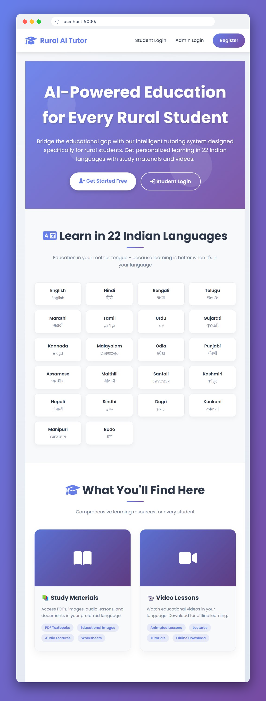

</div>

---

## 📌 Table of Contents

- [About the Project](#-about-the-project)
- [Problem Statement](#-problem-statement)
- [Key Features](#-key-features)
- [Screenshots](#-screenshots)
- [Tech Stack](#-tech-stack)
- [Getting Started](#-getting-started)
- [Usage](#-usage)
- [Project Structure](#-project-structure)
- [Future Enhancements](#-future-enhancements)
- [Contributing](#-contributing)
- [License](#-license)
- [Contact](#-contact)

---

## 📖 About the Project

Students in rural areas often lack qualified teachers, learning resources, and personalized guidance. **Rural AI Tutor** bridges this gap with a cloud-based platform that students can open from any basic device, learn in their **mother tongue**, and download content for **offline learning** in low-connectivity areas.

The platform has two sides:

| 👩‍🎓 Student Portal | 🛠️ Admin Portal |
|---|---|
| Register and log in | Secure admin login |
| Learn in 22 Indian languages | Upload and manage study materials and videos |
| Browse materials and videos by grade (5–12) | Track student activity in real time |
| Earn XP, levels, streaks, and medals | Reports and analytics with CSV export |
| Compete on the global leaderboard | Manage support messages |
| Contact support | Send emails to students |

---

## ❗ Problem Statement

- Shortage of trained teachers and learning support in rural schools
- Language barriers: most quality content is in English
- Poor and unreliable internet connectivity
- High cost of private tuition and coaching

**Our solution:** a low-cost, mobile-first, multilingual learning platform with offline downloads and AI-powered tutoring.

---

## ✨ Key Features

### 👩‍🎓 For Students

- 🤖 **24/7 AI Tutor**: instant answers and explanations anytime
- 🌐 **22 Indian Languages**: Hindi, Telugu, Tamil, Bengali, Marathi, Urdu, Gujarati, Kannada, Malayalam, Odia, Punjabi and more
- 📝 **Easy Registration**: sign up with name, email, grade, preferred language, and optional school name
- 📚 **Study Materials**: PDFs, images, audio lectures, and worksheets
- 🎥 **Video Lessons**: animated lessons, lectures, and tutorials
- 📥 **Offline Access**: download materials and videos for areas with limited internet
- 🎓 **Grade Filters**: browse content by grade (5–12) and subject
- 🏆 **Gamified Learning**: earn XP, level up, keep daily streaks, and collect medals
- 🥇 **Global Leaderboard**: Overall Ranking, Material Masters, Video Learners, Language Leaders, and Polyglots
- 🎯 **Personal Dashboard**: XP progress, achievements, materials studied, videos watched, and recent activity
- 💬 **Contact Support**: send queries with category, priority (Low / Medium / High / Urgent), and an optional attachment (up to 10 MB)
- 📱 **Mobile First**: works on any device, even with low connectivity

### 🛠️ For Admins

- 🔐 **Secure Admin Portal**: restricted login for authorized administrators
- 📊 **Admin Dashboard**: total students, materials, videos, downloads, and views at a glance
- ⚡ **Real-Time Activity Feed**: logins, registrations, views, downloads, video watches, and medals
- 📈 **Student Activity Dashboard**: daily activity chart, filters by type/date/student, CSV export, and print
- 🗂️ **Content Management**: upload PDFs, images, documents, and audio (up to 200 MB) with language, grade, subject, chapter, tags, and description; search, filter, edit, share, download, and delete
- 🌍 **Language Management**: per-language stats for materials, videos, views, downloads, and content coverage
- 📑 **Reports & Analytics**: reports by date range for overview, study materials, video lessons, and student progress; top-performing students; CSV export
- 📨 **Support Inbox**: filter by status, category, and priority; reply or mark resolved
- ✉️ **Email Management**: send to all students, by grade, by language, or individually, with templates (Welcome, New Content Alert, Announcement, Study Reminder, Feedback Request)

---

## 🖼️ Screenshots

### 👩‍🎓 Student Portal

<table>
  <tr>
    <td align="center" width="50%"><b>Student Registration</b><br>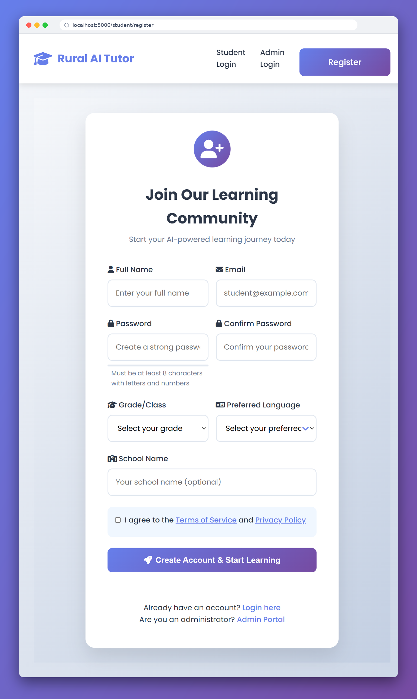</td>
    <td align="center" width="50%"><b>Student Login</b><br>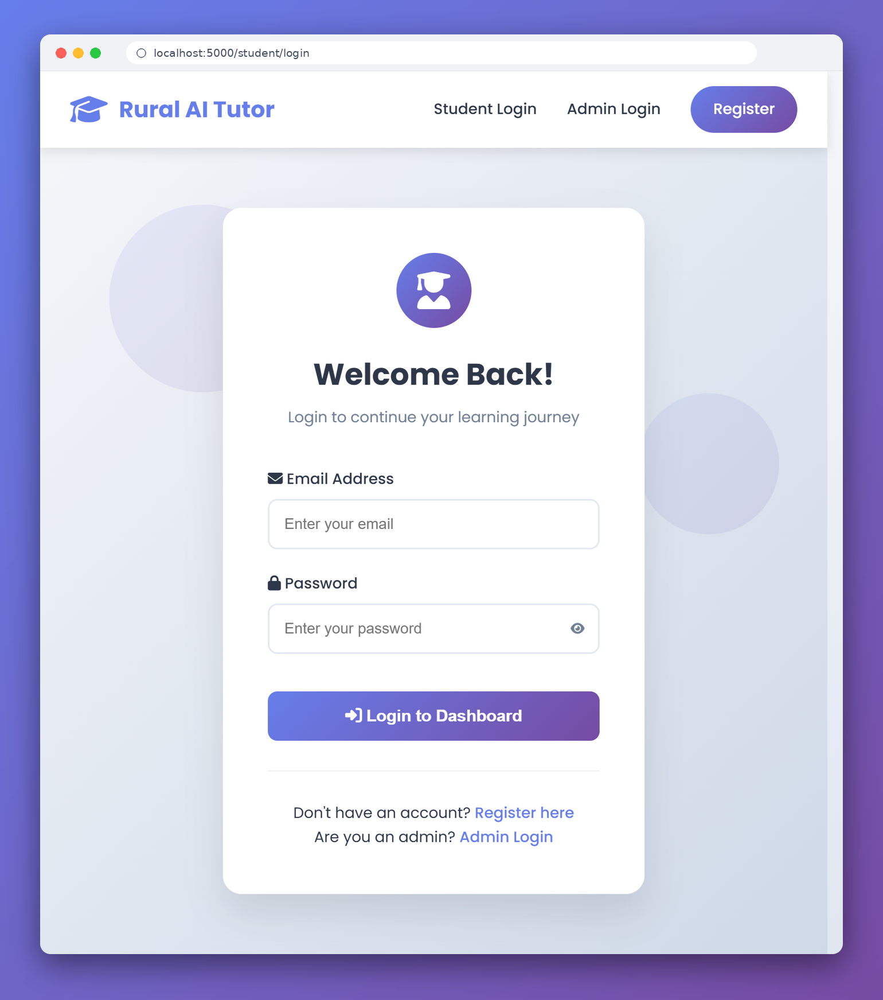</td>
  </tr>
  <tr>
    <td align="center"><b>Student Dashboard</b><br>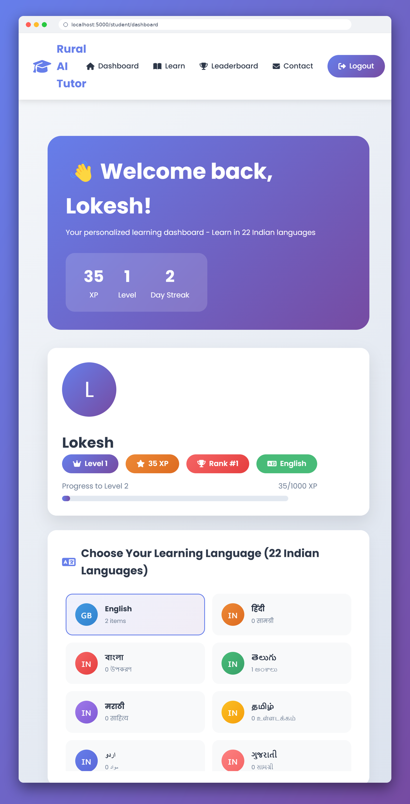</td>
    <td align="center"><b>Learning Page (22 languages)</b><br>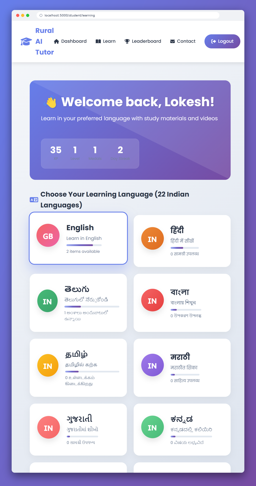</td>
  </tr>
  <tr>
    <td align="center"><b>Global Leaderboard</b><br>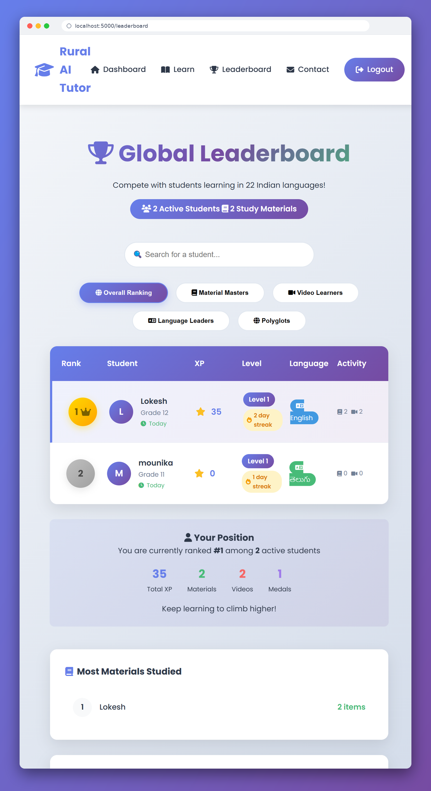</td>
    <td align="center"><b>Contact Support</b><br>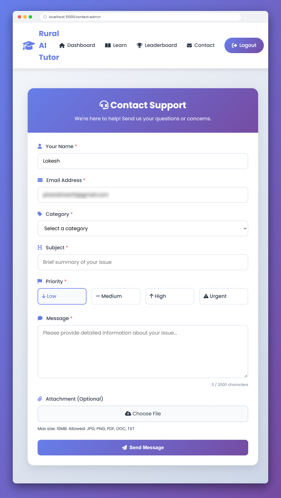</td>
  </tr>
</table>

### 🛠️ Admin Portal

<table>
  <tr>
    <td align="center" width="50%"><b>Admin Login</b><br>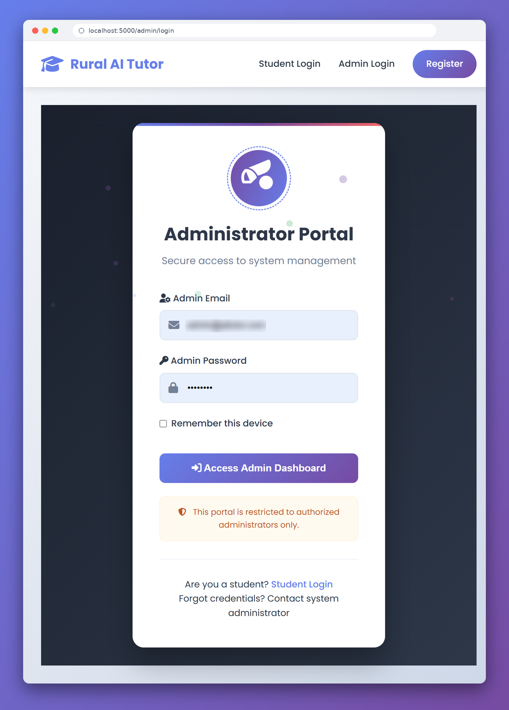</td>
    <td align="center" width="50%"><b>Admin Dashboard</b><br>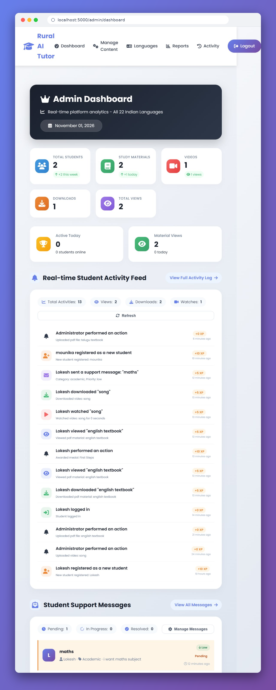</td>
  </tr>
  <tr>
    <td align="center"><b>Content Management</b><br>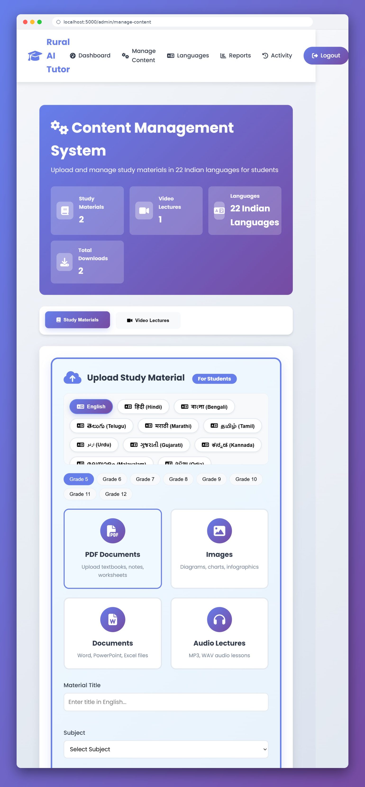</td>
    <td align="center"><b>Language Management</b><br>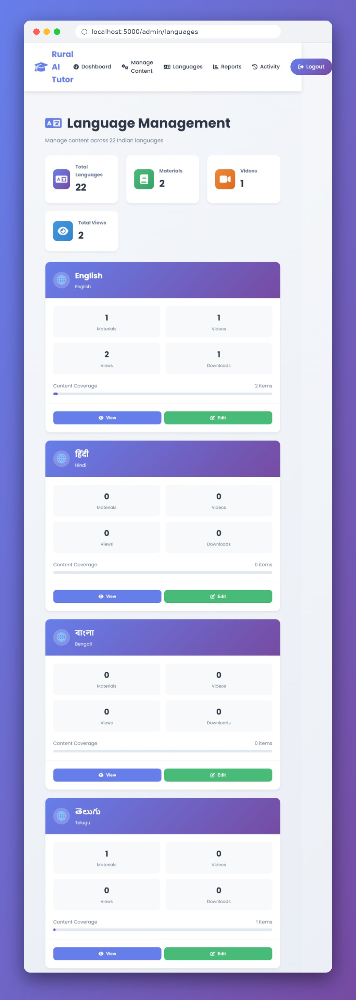</td>
  </tr>
  <tr>
    <td align="center"><b>Reports & Analytics</b><br>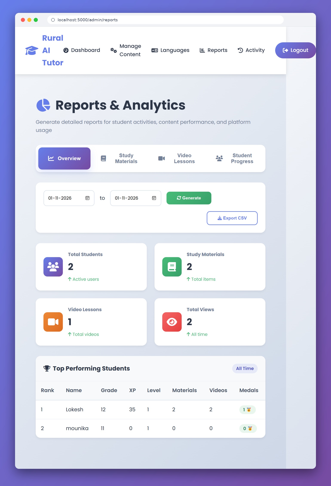</td>
    <td align="center"><b>Student Activity Dashboard</b><br>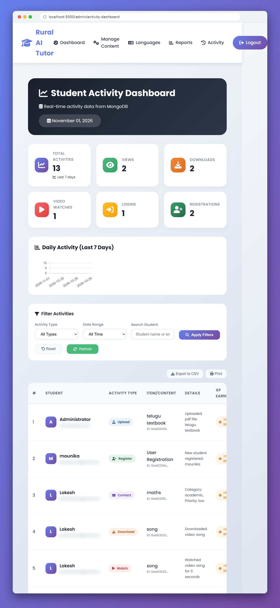</td>
  </tr>
  <tr>
    <td align="center"><b>Activity Log</b><br>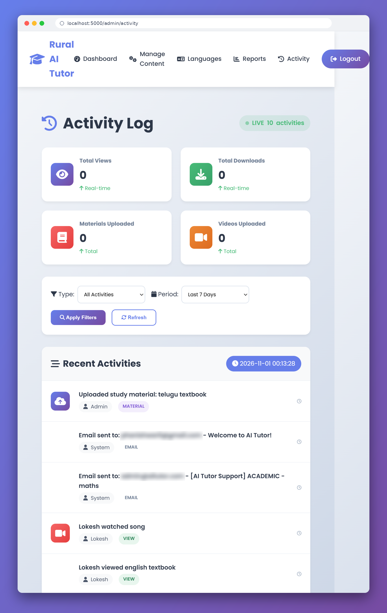</td>
    <td align="center"><b>Student Support Messages</b><br>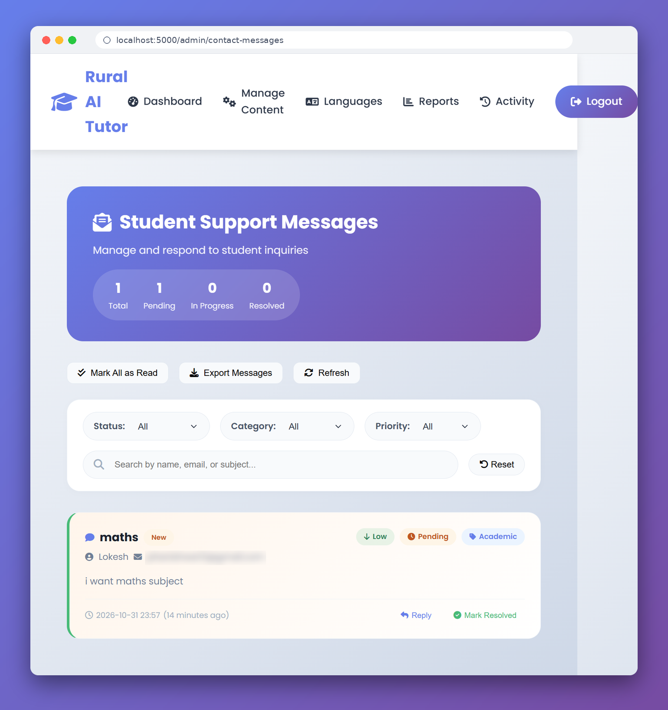</td>
  </tr>
  <tr>
    <td align="center" colspan="2"><b>Email Management</b><br>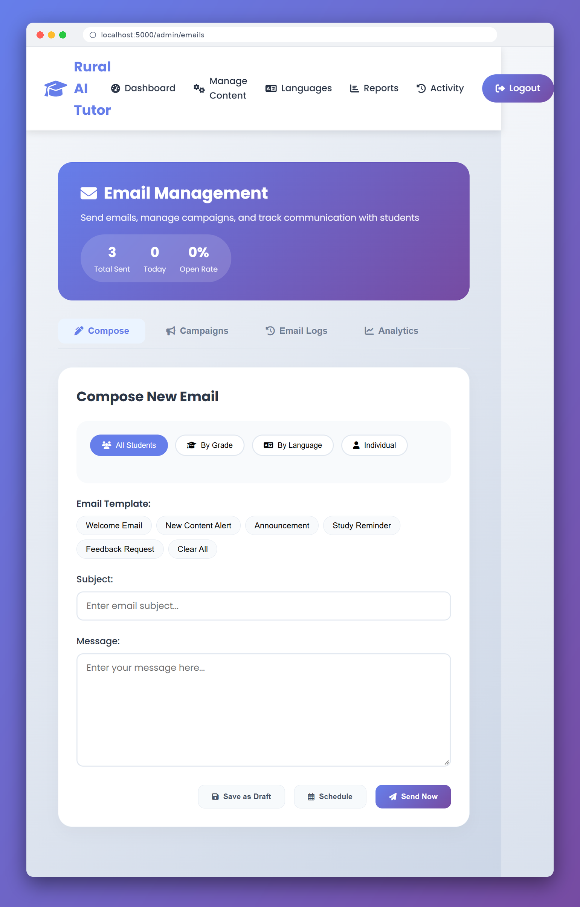</td>
  </tr>
</table>

---

## 🛠️ Tech Stack

| Layer | Technology |
|-------|------------|
| Frontend | HTML, CSS, JavaScript |
| Backend | Python (Flask) |
| Database | MongoDB |
| Email | SMTP email service |
| AI | AI / LLM API for tutoring |
| Deployment | Cloud hosting (AWS / Render / Azure, etc.) |
| Version Control | Git & GitHub |

> ✏️ Adjust this table if your stack differs.

---

## 🚀 Getting Started

### Prerequisites

- [Git](https://git-scm.com/)
- [Python 3.8+](https://www.python.org/downloads/)
- [MongoDB](https://www.mongodb.com/) (local installation or MongoDB Atlas)
- SMTP credentials for sending emails *(optional)*
- AI API key *(if used)*

### Installation

1. **Clone the repository**
   ```bash
   git clone https://github.com/phanishwar0-debug/ai-tutor-project23.git
   cd ai-tutor-project23
   ```

2. **Create a virtual environment**
   ```bash
   python -m venv venv
   source venv/bin/activate      # Windows: venv\Scripts\activate
   ```

3. **Install dependencies**
   ```bash
   pip install -r requirements.txt
   ```

4. **Configure environment variables**

   Create a `.env` file in the project root:
   ```env
   MONGO_URI=mongodb://localhost:27017/ai_tutor
   SECRET_KEY=your_secret_key
   MAIL_USERNAME=your_email@gmail.com
   MAIL_PASSWORD=your_app_password
   API_KEY=your_ai_api_key
   ```

5. **Run the application**
   ```bash
   python app.py
   ```

6. Open **http://localhost:5000** in your browser.

---

## 💡 Usage

**Student**
1. Register or log in from the landing page.
2. Choose your language and grade, then browse study materials and video lessons.
3. Download content for offline use and earn XP and medals as you learn.
4. Check the leaderboard, or message support if you need help.

**Admin**
1. Log in via **Admin Login**.
2. Use the **Dashboard** to monitor students and activity.
3. Upload content under **Manage Content**.
4. Reply to students in **Support Messages** and send updates from **Email Management**.

> ⚠️ Change any default admin credentials before deploying publicly.

---

## 📂 Project Structure

```
ai-tutor-project23/
├── app.py                # Main Flask application
├── requirements.txt      # Python dependencies
├── .env                  # Environment variables (do not commit)
├── templates/            # HTML templates (student + admin pages)
├── static/               # CSS, JavaScript, images, uploads
├── screenshots/          # README screenshots
└── README.md
```

> ✏️ Update to match your actual folder structure.

---

## 🔮 Future Enhancements

- 🎙️ Voice-based interaction for low-literacy students
- 📴 Full offline mode (PWA)
- 📱 Dedicated Android app
- 🧑‍🏫 Teacher and parent dashboards
- 📝 Quizzes and automated progress reports
- 🔔 SMS / WhatsApp notifications

---

## 🤝 Contributing

1. Fork the repository
2. Create a branch: `git checkout -b feature/your-feature`
3. Commit: `git commit -m "Add your feature"`
4. Push: `git push origin feature/your-feature`
5. Open a Pull Request

---

## 📄 License

This project is licensed under the **MIT License**.

---

## 📬 Contact

**Project Owner:** [phanishwar0-debug](https://github.com/phanishwar0-debug)

**Project Link:** [github.com/phanishwar0-debug/ai-tutor-project23](https://github.com/phanishwar0-debug/ai-tutor-project23)

<div align="center">

⭐ If you like this project, please give it a star!

*Built with ❤️ to make quality education accessible to every rural student.*

</div>
